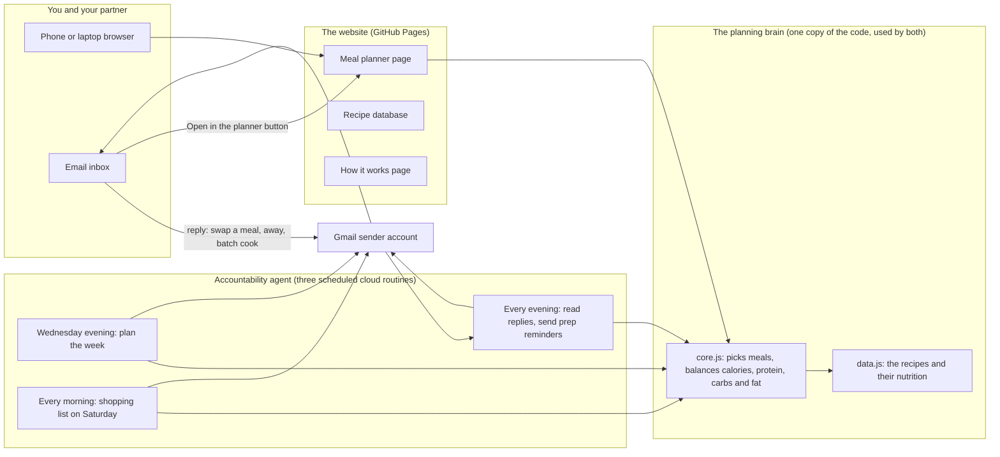

# Meal Planner

A pure-vegetarian meal planner for two people who cook one pot. It picks a breakfast, lunch and dinner for every day, sizes each person's portions so their calories, protein, carbs and fat are about right, and then **an email assistant does the nagging for you**: it sends the week's plan, the shopping list, and each evening's "soak the chickpeas" reminders.

You do not need to know how to code to understand this page.

---

## What it does, in plain words

1. **You pick dates** (1 to 14 days) and tell it, optionally, your gender, weight and how active you are.
2. **It builds a menu.** Each meal is one to three dishes. It chooses how many servings of each dish, so the meal lands on your calorie target and has a healthy mix of protein, carbs and fat.
3. **For two people it keeps the dishes the same but changes the portions.** One pot, two plates, each sized for the person eating it.
4. **The email assistant (the "accountability agent")** runs by itself on a schedule. It plans the week, emails the menu, emails a combined shopping list on shopping day, and emails each evening what to prepare for tomorrow. You can reply to an email ("change Thursday dinner", "we're away Friday", "batch cook this week") and it adjusts.

---

## The big picture



The same picture as plain text, in case your viewer doesn't draw diagrams:

```
   YOU & PARTNER                         THE WEBSITE                    THE BRAIN
 ┌───────────────┐   open page   ┌──────────────────────┐   uses   ┌──────────────────┐
 │ phone/laptop  │ ────────────▶ │ planner · recipes ·  │ ───────▶ │ core.js  (rules) │
 │ browser       │               │ how it works         │          │ data.js (recipes)│
 └───────────────┘               └──────────────────────┘          └──────────────────┘
        ▲                                                                   ▲
        │ "Open in the planner" button                                      │ same code
        │                                                                   │
 ┌───────────────┐   emails    ┌───────────┐    runs on a schedule  ┌───────────────────┐
 │ email inbox   │ ◀────────── │   Gmail   │ ◀───────────────────── │ 3 cloud routines  │
 │               │ ──replies─▶ │ (sender)  │ ──────replies────────▶ │ weekly · morning ·│
 └───────────────┘             └───────────┘                        │ evening           │
                                                                    └───────────────────┘
```

---

## A week with the assistant

| When (Eastern time) | What arrives | What you do |
|---|---|---|
| **Wednesday evening** | The plan for next week: every day's breakfast, lunch and dinner, with each person's portions, in colour-coded boxes. | Read it. Reply if you want a change. |
| **Friday evening** | "You shop tomorrow" with the week's menu. | Check your pantry. |
| **Saturday morning** | One combined shopping list, grouped (produce, dals and grains, dairy, spices, other) with tick boxes. | Go shopping. |
| **Every evening** | Tomorrow's menu, plus jobs for tonight: "start sprouting", "soak the chickpeas", "batter needs fermenting". | Do the prep. |
| **Any time** | Reply to a plan email with a change. The evening run reads it and sends an updated plan. | Just reply in plain English. |

The emails are written for both phones and computers: on a wide screen the three meals sit side by side in equal-height boxes, on a phone they stack.

---

## How the planner picks meals (the short version)

- It starts from a **daily calorie target** for each person. These come from the Indian national guidelines (ICMR-NIN) for a "reference man" and "reference woman", scaled by your weight, with three activity levels.
- The day is split **30% breakfast, 35% lunch, 35% dinner**.
- For every meal it tries thousands of combinations of dishes and portion sizes (in half-serving steps) and keeps only the ones where calories are close to target and protein, carbs and fat fall in healthy ranges. It picks one of the best, so plans are balanced but still varied.
- A daily **sattu cucumber yoghurt drink** is added to every lunch, and the rest of lunch is balanced around it.
- Recipe nutrition is **worked out from each ingredient list** using US government food data (USDA). Spices, herbs and salt count as zero. When an amount is missing, the recipe says "not available" instead of guessing.

The full, jargon-free explanation lives on the **How it works** page of the website (`how-it-works.html`).

---

## What lives where

| File or folder | What it is |
|---|---|
| `index.html`, `planner.js` | The planner page: date picker, plan view, shopping list, reminders download. |
| `recipes.html`, `recipes.js` | The recipe database page with search, nutrition and videos. |
| `how-it-works.html` | The plain-language guide to the science. |
| `data.js` | All the recipes, ingredients and nutrition numbers. |
| `core.js` | **The planning brain.** Picks meals, balances nutrition, builds and rebuilds plans. Shared by the website and the agent. |
| `reminders.js` | Prep tips and the calendar-file reminders. |
| `common.js`, `style.css` | Small helpers and the look of the website. |
| `agent/agent.js` | The email assistant's tool: plans a week, writes the HTML emails, rebuilds a plan from its short ID. |

Everything on the site is plain files: no database, no server, no account. A person's plan is saved only in their own browser, and a plan can be shared as a link.

---

## How the assistant remembers the plan

The assistant has no memory between runs, so every plan email contains one small line:

```
Plan ID: start=2026-11-23 days=7 mode=fresh seed=auto2 data=... edits=none
```

From that line (plus the people's settings, kept in the scheduled routine) the planning brain can **rebuild the exact same plan** any day. A reply like "change Thursday dinner" just adds an entry to `edits`, and the assistant sends an "Updated meal plan" email with the new line.

The `data=` part is a fingerprint of the recipes the planner can pick from. If those recipes change in the middle of a week, a rebuilt plan could differ from the one that was emailed, and the assistant says so instead of quietly sending the wrong menu.

---

## Trying it yourself

- **The website:** open `index.html` in a browser. No install needed.
- **The email tool** (needs Node.js):

  ```
  node agent/agent.js plan --today 2026-11-21 --people '[{"name":"A","gender":"male","kg":75,"activity":"sedentary"},{"name":"B","gender":"female","kg":65,"activity":"sedentary"}]' --format html
  ```

  This prints one email: a `SUBJECT:` line, a `FORMAT: html` line, then the page. The other commands (`nudge`, `rebuild`, `decode`, `link`) are described at the top of `agent/agent.js`.

Personal details (names, weights, email addresses) are never stored in this repository. They are given to the tool when it runs.

---

## Honest limits

- It is a **general guide, not medical or dietary advice**. It does not know about health conditions, allergies, age, height or goals.
- Nutrition numbers are estimates from ingredient lists and could be off by 10% to 30%.
- The healthy ranges for protein, carbs and fat are borrowed from US and Canadian guidance, because India-specific ranges could not be verified.
- Recipe videos belong to their creators and can disappear.
- The email assistant acts on its schedule, so a reply is picked up the next evening, not instantly.
